## Where would a regression tree put its prediction?

:::: {.columns}
::: {.column width="56%"}
::: {.r-stack .plot}
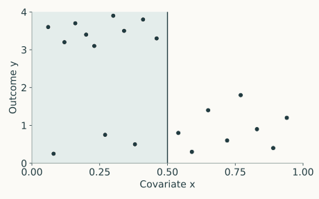{fig-alt="Twenty observations. The CART leaf to the left of x = 0.5 contains twelve points in two bands."}

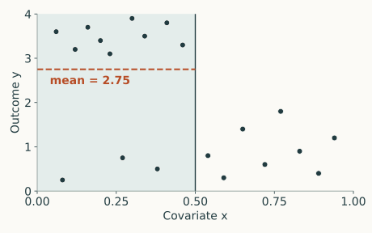{.fragment data-fragment-index="1" fig-alt="The left leaf's mean is 2.75, in the gap between the bands."}
:::
:::
::: {.column width="44%"}
A CART split groups observations by $x$. Look at the **12 points in the shaded leaf**.

In classification, class frequencies give us a probability for each label.

::: {.fragment data-fragment-index="1"}
In squared-error regression, the prediction is the leaf mean, **2.75**. What does it tell us about the gap?
:::
:::
::::

::: {.notes}
Ask for a prediction before revealing the line. Every observation in this leaf is either below 1 or above 3. The mean is a good answer to a squared-error question. If we want to know what a future outcome might look like, the empty space between the bands matters too.
:::

## A probability space $(\Omega, \mathcal{F}, P)$ {#probability-as-a-measure}

:::: {.columns}
::: {.column width="27%"}
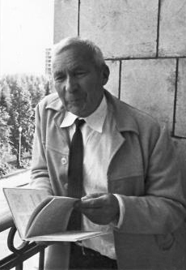{width="270" fig-alt="Archival photograph of Andrei Kolmogorov holding an open book."}

**Andrei Kolmogorov**  
[*Foundations of the Theory of Probability*, 1933](https://www.york.ac.uk/depts/maths/histstat/kolmogorov_foundations.pdf){.source}
:::
::: {.column width="73%"}
::: {.r-stack .plot}
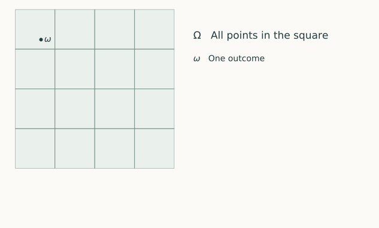{fig-alt="The sample space is the whole square. A dot marks one possible outcome inside the upper-left tile of a four-by-four grid."}

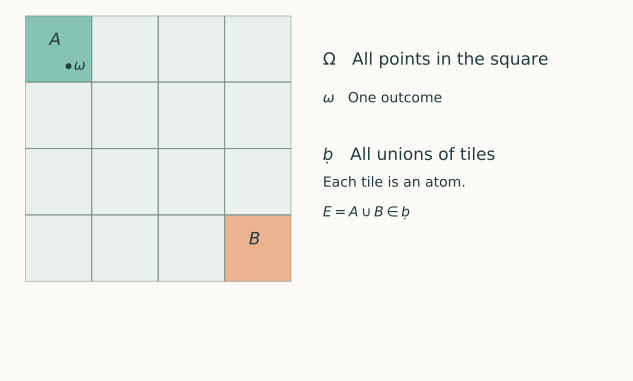{.fragment data-fragment-index="1" fig-alt="Each tile is an atom. The upper-left tile A and lower-right tile B are highlighted. Their union is the event E."}

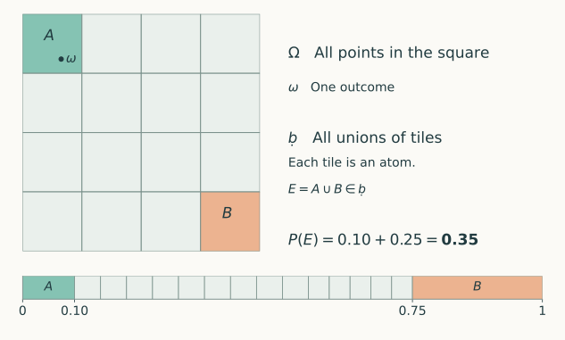{.fragment data-fragment-index="2" fig-alt="A ruler from zero to one assigns a segment to each tile. The highlighted segments have lengths 0.10 and 0.25, giving the event probability 0.35."}

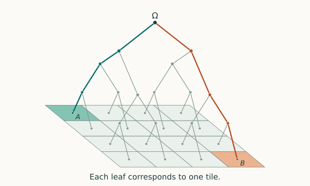{.fragment data-fragment-index="3" fig-alt="A binary tree stands above the same square in perspective. Its root represents the whole square. Four levels of splits lead to 16 leaves, one on each tile. Teal and orange paths end at A and B."}
:::
:::
::::

::: {.notes}
Kolmogorov’s 1933 framework gives discrete and continuous probability the same starting point. Point to the dot. Any point in the square can be the outcome $\omega$.

First click: the grid defines which questions we can ask. “Did the point land in either shaded tile?” is one event. Each tile contains infinitely many points and is an atom of this $\sigma$-algebra. Choosing which of the 16 tiles to include gives $2^{16}$ events.

Second click: read the ruler from left to right in the same order as the tiles, row by row. Segment length shows probability. The shaded tiles have equal area but carry different masses. Since they are disjoint, their probabilities add.

Third click: start at the root, the whole square. Each fork cuts the current rectangle in half. Follow the teal path through four cuts to reach tile $A$. The orange path ends at $B$. Our event is the union of those two leaves. Here we chose the cuts by hand. Where would a tree cut if it learned from the data?

For a continuous example, keep the same square, choose its Borel $\sigma$-algebra, and let probability be uniform area. Now each singleton is an event of probability zero, while the whole square has probability one. Countable additivity is consistent with that because the square contains uncountably many points.

Photograph by Konrad Jacobs, © Mathematisches Forschungsinstitut Oberwolfach. [Portrait on Wikimedia Commons](https://commons.wikimedia.org/wiki/File:Andrej_Nikolajewitsch_Kolmogorov.jpg) · [CC BY-SA 2.0 DE](https://creativecommons.org/licenses/by-sa/2.0/de/)
:::

## What if we also split the outcome?

:::: {.columns}
::: {.column width="56%"}
::: {.r-stack .plot}
{fig-alt="The same twelve observations in the left covariate band."}

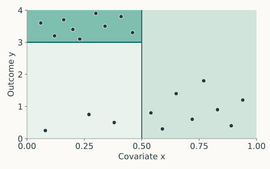{.fragment data-fragment-index="1" fig-alt="A horizontal cut at y = 3 divides the left band. The narrow upper cell is darkest and contains nine points."}
:::
:::
::: {.column width="44%"}
Keep the same $x$-band. Make one cut at $y=3$.

::: {.fragment data-fragment-index="1"}
**Nine** observations fall in the top unit of height. **Three** occupy the lower three units.
:::

::: {.fragment data-fragment-index="2"}
Per unit of outcome space, the upper cell is **nine times as dense**.
:::
:::
::::

::: {.notes}
Give the audience a moment to count. The lower cell holds a quarter of the mass over three quarters of the height. Each rectangle will get one density. A further split could distinguish the little cluster near zero from the gap above it.
:::

## Measuring the mass in a rectangle

:::: {.columns}
::: {.column .plot width="52%"}
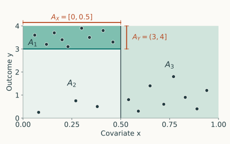{fig-alt="The upper-left cell is A1, the lower-left cell is A2, and the right cell is A3. Brackets mark A1's horizontal span, A_X = [0, 0.5], and vertical span, A_Y = (3, 4]."}

::: {.fragment data-fragment-index="3"}
$$\widehat c(x,y)=
\begin{cases}
3/4  & (x,y)\in A_1,\\
1/12 & (x,y)\in A_2,\\
1/4  & (x,y)\in A_3.
\end{cases}$$
:::
:::
::: {.column width="48%"}
Take the upper-left cell $A=A_1=A_X\times A_Y$.

**Joint mass** counts points in the cell.
$$\widehat P_{XY}(A)=9/20$$

::: {.fragment data-fragment-index="1"}
**Marginal mass** counts every point in its $x$-band.
$$\widehat P_X(A_X)=12/20$$
:::

::: {.fragment data-fragment-index="2"}
The cell holds $9/12$ of the band's outcomes over a height of $\mu_Y(A_Y)=1$.
:::

::: {.fragment data-fragment-index="3"}
$$\widehat c_A=\frac{n_{XY}(A)}{n_X(A_X)\,\mu_Y(A_Y)}
=\frac{9}{12\cdot 1}=\frac34.$$
:::
:::
::::

::: {.notes}
Trace the rectangle, then extend it vertically to cover its entire x-projection. Both mass estimates count the same twenty observations, so the sample size cancels in their ratio. Read the density formula against the picture. The upper-left cell has mass 3/4 over one unit of height. The lower-left cell has mass 1/4 over three units. On the right, all eight outcomes share one cell of height four, giving density 1/4.
:::

## Which split should the tree make?

:::: {.columns}
::: {.column width="50%"}
::: {.r-stack .plot}
{fig-alt="The parent leaf spans four units of outcome space."}

{.fragment data-fragment-index="1" fig-alt="The two children have distinct density estimates, shown by their shading."}
:::
:::
::: {.column width="50%"}
The parent assigns density **$1/4$** throughout the band.

::: {.fragment data-fragment-index="1"}
After the cut, the upper density is **$3/4$**. The lower density is **$1/12$**.
:::

::: {.fragment data-fragment-index="2"}
Score each observation by the change in its log density. For this cut,
$$\widehat G
=\frac{9\log 3+3\log(1/3)}{20}
\approx \mathbf{0.33}.$$
:::
:::
::::

::: {.notes}
The parent density is 12 divided by the product of 12 and 4. In the upper cell the density triples. In the lower cell it falls to a third of the old value. The eight points on the right have no change in score. The denominator is twenty because this gain is measured per training observation across the whole tree. These are natural logarithms, so the gain is in nats per observation.
:::

## Growing a Partition Tree

Try each admissible **$X$ or $Y$ split** in each current leaf. Compare the two children with their parent using the same gain.

$$\widehat G(A\to L,R)=
\sum_{B\in\{L,R\}}\frac{n_{XY}(B)}{N}
\log\frac{\widehat c_B}{\widehat c_A}$$

::: {.fragment}
Split the leaf with the **largest reduction in the training log-loss surrogate**. Repeat until the split budget is spent or no admissible split remains.
:::

::: {.fragment}
Sorted thresholds need one scan per coordinate. For balanced growth, the paper gives **$O(d_Z N\log N)$** with maintained presorted indices, the same order as presorted CART.
:::

::: {.notes}
An x-cut changes which observations supply the covariate denominator. A y-cut keeps that denominator and changes the outcome volumes. The gain uses unnormalized leaf heights, which makes it local. A priority queue keeps the best split available at every leaf. Here d_Z counts the splittable input and outcome coordinates. Sorting afresh within each node gives the balanced-tree comparison O(d_Z N log² N). These are training costs.
:::

## Predicting with Partition Tree

:::: {.columns}
::: {.column .plot width="48%"}
::: {.r-stack}
{fig-alt="The query point (0.25, 3.5), marked with a diamond, lies inside the upper-left cell."}

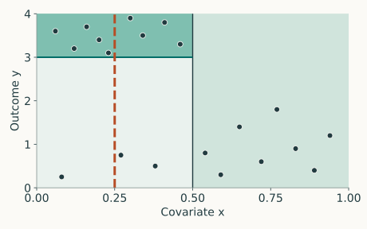{.fragment data-fragment-index="1" fig-alt="A vertical line at x = 0.25 crosses both leaves on the left."}
:::

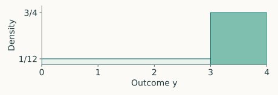{.fragment data-fragment-index="1" fig-alt="Conditional histogram at x = 0.25. The horizontal axis is outcome y. The bar over 0 to 3 has height 1/12, and the bar over 3 to 4 has height 3/4."}
:::
::: {.column width="52%"}
**Given $(x,y)=(0.25,3.5)$**, follow one branch at every split. The leaf height here is $3/4$.

::: {.fragment data-fragment-index="1"}
**Given only $x=0.25$**, follow the matching branch at each $X$-split and **both** branches at each $Y$-split.
:::

::: {.fragment data-fragment-index="2"}
The slice is a histogram. Its two bin areas are $3\times(1/12)=1/4$ and $1\times(3/4)=3/4$.
:::
:::
::::

::: {.notes}
Trace the diamond, then click and trace the vertical line. For this particular tree the areas already sum to one. In general, leaves on a slice can have different covariate denominators. Divide all heights by the sum of height times outcome volume to obtain a proper conditional density. A normalized point query also needs this factor, which can be obtained from the slice. Integrating the histogram then answers probability and quantile questions.
:::

## A forest averages the trees' densities

A bootstrap sample moves split boundaries. Fit a Partition Tree to each sample and average the heights at the same $(x,y)$.

$$h_F(x,y)=\frac{1}{B}\sum_{b=1}^{B}\widehat c_{A_b(x,y)}$$

::: {.fragment}
For each $x$, normalize the slice so its area is one.
$$\widehat f_F(y\mid x)=
\frac{h_F(x,y)}{\int h_F(x,u)\,d\mu_Y(u)}$$
:::

::: {.notes}
Each tree can choose different bin edges. Evaluate the trees on their common slice and average their heights, then normalize. With one tree the same normalization rule applies. The next two datasets let us compare the resulting shapes with a density we know because we generated the data.
:::

## The mean stays put as the spread changes

::: {.plot}
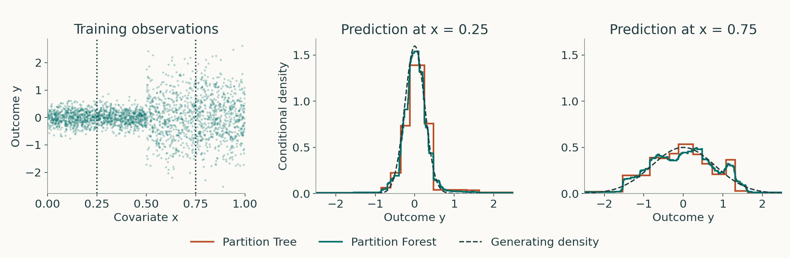{fig-alt="Simulated outcomes spread out after x = 0.5. At x = 0.25 the tree and forest have a narrow central peak. At x = 0.75 both conditional densities are wider."}
:::

::: {.fragment .result}
Both slices center near zero. The wider slice assigns more probability to large errors.
:::

::: {.notes}
Start with the observations at left. The two dotted lines mark the x values used for prediction. The two density panels share their scales. The generating law is normal with mean zero and standard deviation 0.25 on the left or 0.80 on the right. The rust steps are a single fitted tree. The teal steps average fifty bootstrap trees. The dashed curve is the generating density. The fits use 2,400 observations and at most 45 leaves per tree.
:::

## Two modes can trade probability mass

::: {.plot}
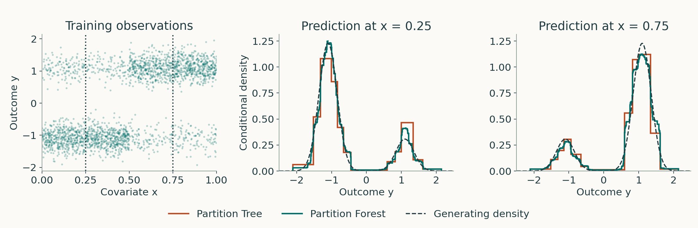{fig-alt="Two horizontal bands of simulated outcomes. The left peak of the conditional density is larger at x = 0.25, and the right peak is larger at x = 0.75. Both tree and forest assign little density to the gap."}
:::

::: {.fragment .result}
The peaks stay near $-1.1$ and $+1.1$. Moving across $x$ changes **which outcome is more likely**.
:::

::: {.notes}
Each band has standard deviation 0.26. The upper band's probability changes from 20% to 80% at x = 0.5. A point prediction can land between the bands, just as the opening CART mean landed in the gap. Compare how the tree and the fifty-tree forest represent both peaks for the same query. These are illustrative fits on simulated data. The next tables report the paper's cross-validation results.
:::

## Classification log-loss across nine datasets

::: {.benchmarks}
| Dataset | Partition Tree | CART | Partition Forest | Random Forest |
|:---|---:|---:|---:|---:|
| Iris | 0.46 | 0.46 | 0.50 | 0.15 |
| Breast | 0.64 | 0.70 | 0.58 | 0.56 |
| Wine | 1.02 | 1.47 | 0.86 | 0.88 |
| Digits | 0.45 | 1.48 | 0.29 | 0.29 |
| Spam | 0.22 | 0.29 | 0.17 | 0.16 |
| Support2 | 0.28 | 0.28 | 0.24 | 0.25 |
| Letter | 0.62 | 1.42 | 0.49 | 0.28 |
| Bank | 0.22 | 0.22 | 0.20 | 0.20 |
| Adult | 0.93 | 0.92 | 0.90 | 0.90 |
| **Average rank** | **1.33** | 1.67 | **1.44** | 1.56 |
:::

::: {.source}
Five-fold means. Lower is better. Ranks compare single trees and forests separately. [Angelim & Leite, Table 1a](https://arxiv.org/pdf/2602.04042v3#page=8)
:::

::: {.fragment}
Partition Tree scored lower log-loss than CART on **6 of 9** datasets.
:::

::: {.notes}
On Digits, the single tree improves substantially over CART, while the two ensembles round to the same score. On Letter, Random Forest wins the ensemble comparison. The paper reports a lower mean loss for Partition Tree than CART on six of nine datasets and for Partition Forest than Random Forest on five. Some means coincide at the displayed precision. The paper gives fold standard deviations and paired comparisons.
:::

## Regression log-loss across ten datasets

::: {.benchmarks}
| Dataset | Partition Tree | CART | CADET | CDTree | Partition Forest | RF |
|:---|---:|---:|---:|---:|---:|---:|
| Diabetes | 5.65 | 17.93 | 5.59 | 5.58 | 5.49 | 14.21 |
| Boston | 2.90 | 8.39 | 2.89 | 2.88 | 2.53 | 4.60 |
| Energy | 2.36 | 1.67 | 10.81 | 1.55 | 2.06 | 1.55 |
| Concrete | 3.70 | 7.45 | 3.52 | 3.66 | 3.36 | 3.86 |
| Kin8nm | −0.18 | 9.42 | −0.22 | −0.18 | −0.45 | 3.30 |
| Air | 2.12 | 13.49 | 13.78 | 6.42 | 2.02 | 11.35 |
| Power | 2.87 | 3.13 | 2.90 | 2.93 | 2.60 | 2.63 |
| Naval | −4.38 | 4.69 | −4.78 | −4.29 | −4.72 | −4.98 |
| California | 0.69 | 7.07 | 0.88 | 0.58 | 0.42 | 3.11 |
| Protein | 2.22 | 12.31 | 3.13 | 2.18 | 2.10 | 6.19 |
| **Average rank** | 2.30 | 3.70 | 2.30 | **1.70** | **1.20** | 1.80 |
:::

::: {.source}
Five-fold means. Lower is better. CART and Random Forest (RF) use Gaussian residuals. [Angelim & Leite, Table 1b](https://arxiv.org/pdf/2602.04042v3#page=8)
:::

::: {.fragment}
CDTree led the single trees. Partition Forest beat RF on **8 of 10** datasets.
:::

::: {.notes}
Among the four single trees, CDTree has the best average rank, and Partition Tree ties CADET. In the last two columns, Partition Forest has lower mean log-loss on eight of ten datasets. Energy and Naval favor RF. These numbers score the predictive density. On the separate point-prediction metric, Random Forest has the better average RMSE rank. Read log-loss within a dataset because continuous density depends on the outcome units.
:::

## Future Research

**Balancing Partition Forest.** Can the same rectangles give us weights that balance treatment and covariates in observational data?

::: {.source}
[Angelim & Leite, *Balancing Partition Forest for Causal Weighting*](https://arxiv.org/abs/2611.23524v1)
:::

::: {.fragment}
**Flow Partition Tree.** Can a sequence of tree-based transformations improve probabilistic regression?
:::

::: {.notes}
The balancing work uses each rectangle to estimate the ratio of independent covariate and treatment mass to their observed joint mass. The flow direction asks how far we can take tree-based conditional distributions by composing transformations.
:::
